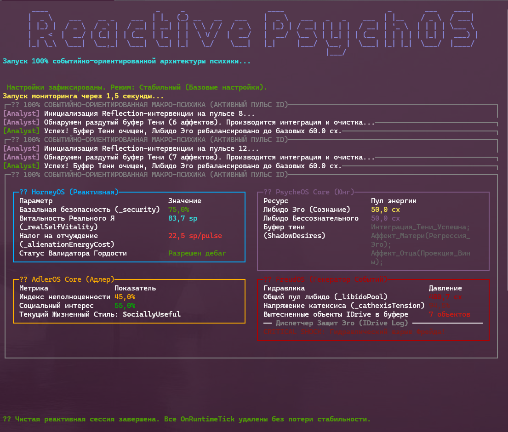

# 📊 Макро-Психика: Мета-Контекст Психологических Рантаймов

Программный комплекс, моделирующий четыре ключевые психологические школы в виде строго типизированных изолированных рантаймов на платформе **.NET 9.0** и **C# 13**. Визуализация и мониторинг состояний ядра осуществляются в реальном времени через консольный дашборд **Spectre.Console**.

---

## 🛠️ Архитектура Систем и Ресурсы Состояния

### 🌟 1. Проект «HorneyOS» (Психоанализ Карен Хорни)

Фокусируется на межличностных стратегиях защиты и конфликте между Реальным и Идеализированным Я.

* **`_security` (Базальная безопасность)** — `double` (`%`). Критический порог — **`< 20.0%`** (Базальная тревога и паника рантайма).
* **`_realSelfVitality` (Витальность Реального Я)** — `double` (`sp`, Спонтаны). Ресурс истинных желаний и спонтанности.
* **`_alienationEnergyCost` (Налог на отчуждение)** — `double` (`sp/tick`). Пассивный дебафф от `ShouldsTyrannyDecorator`. При **`> 50.0 sp/tick`** активируется `NeuroticPrideValidator`, генерирующий `ResistanceException` и блокирующий Reflection-интервенции аналитика.

### 🌑 2. Проект «PsycheOS» (Аналитическая психология К. Г. Юнга)

Управляет распределением психической энергии между эго-сознанием и автономными комплексами.

* **`Libido` (Психическая энергия)** — `double` (`cx`). Распределяется между Эго и Бессознательным через класс `PsychicEnergy`.
* **`ShadowDesires`** — `string` (Буфер Тени). Динамически накапливает вытесненные аффекты при активации комплексов (`MotherComplex`, `FatherComplex`, `AnimaProxy`).

### 📉 3. Проект «AdlerOS» (Индивидуальная психология Альфреда Адлера)

Моделирует компенсацию чувства неполноценности через телеологические (целевые) жизненные стратегии.

* **`_inferiorityIndex` (Индекс неполноценности)** — `double` (`%`). Мера внутреннего дефицита.
* **`_socialInterest` (Социальный интерес)** — `double` (`%`). Противовес эгоцентрической компенсации.
* **`IStyleOfLife` (Стиль жизни)** — паттерн *Strategy*. Переключает систему между `SociallyUsefulStyle` и `RulingStyle` (Сверхкомпенсация) на основе индекса.

### 🩸 4. Проект «FreudOS» (Классический психоанализ Зигмунда Фрейда)

Низкоуровневый, гидравлический слой психики, отвечающий за управление памятью и вытеснение импульсов Id.

* **`_libidoPool` (Общий пул либидо Эго)** — `double` (`cx`, Катексисы). Тратится на удержание подавленного материала.
* **`_cathexisTension` (Напряжение катексиса)** — `double` (`%`). Уровень давления в буфере. При **`> 90.0%`** выбрасывает `LibidoLeakException` (гидравлический прорыв влечений через конверсионный симптом).
* **`_repressionCost` (Затраты на вытеснение)** — `double` (`cx/tick`). Налог на пассивное удержание импульсов Id в подсознании.

---

## ⚙️ Спецификация Контракта Влечений (IDrive)

Вместо сырых строковых триггеров рантайм `FreudOS` использует строго типизированный полиморфизм влечений:

* **`IDrive`** — базовый интерфейс влечения, инкапсулирующий его категорию (`DriveType`), техническую метку (`TechnicalLabel`) и силу энергетического давления (`EnergyOutput`).
* **`ErosDrive` (Влечение к жизни)** — генерирует `15.0 cx`. Успешно разряжается Эго, снижая уровень системного напряжения `_cathexisTension`.
* **`ThanatosDrive` (Влечение к смерти)** — генерирует `25.0 cx`. Автоматически блокируется компонентом `Superego` и принудительно отправляет Эго к диспетчеру защит (`Repression` или `Sublimation`).

---

## 📈 Сводная спецификация метрик макро-психики

| Рантайм | Метрика состояния | Единица измерения | Базовое значение | Критический триггер |
| :--- | :--- | :--- | :--- | :--- |
| **HorneyOS** | `_security` | `%` (Проценты) | `80.0%` | `< 20.0%` (Runtime Panic) |
| | `_realSelfVitality` | `sp` (Спонтаны) | `100.0 sp` | `0.0 sp` (Деперсонализация) |
| | `_alienationEnergyCost` | `sp/tick` | `5.0 sp/tick` | `> 50.0 sp/tick` (Pride Lockout) |
| **PsycheOS** | `Libido` (Ego / Unconscious) | `cx` (Катексисы) | `60.0 / 40.0` | Динамический баланс аффекта |
| **AdlerOS** | `_inferiorityIndex` | `%` (Проценты) | `45.0%` | `> 70.0%` (Сверхкомпенсация) |
| **FreudOS** | `_libidoPool` | `cx` (Катексисы) | `500.0 cx` | `0.0 cx` (Ступор Эго) |
| | `_cathexisTension` | `%` (Напряжение) | `15.0%` | `> 90.0%` (`LibidoLeakException`) |

---

## 🔄 Каскадное межсистемное взаимодействие (Data-Bus Triggers)

Рантаймы не изолированы, а связаны через каузальные интерфейсы взаимодействия:

```sh
[FreudOS: Вытеснение растет]
│
├──> (Перелив аффекта) ──> [PsycheOS: Накопление в ShadowDesires]
│
[HorneyOS: Падение _security]
│
└──> (Рост уязвимости) ──> [AdlerOS: Рост _inferiorityIndex] ──> Переключение в RulingStyle
```

1. **Гидравлический сдвиг Юнга:** Рост `_cathexisTension` во FreudOS приводит к десанкционированному перетоку либидо из Эго в Бессознательное внутри PsycheOS, пополняя текстовый буфер `ShadowDesires` строками спроецированных аффектов (`Thanatos_Projected`).
2. **Адлерианская компенсация Хорни:** Когда `ShouldsTyrannyDecorator` в HorneyOS выжигает базальную безопасность (`_security < 65%`), этот слепок данных перехватывается AdlerOS. Индекс неполноценности `_inferiorityIndex` резко возрастает, принудительно переключая текущую стратегию `IStyleOfLife` в агрессивный режим `RulingStyle` для сверхкомпенсации.


